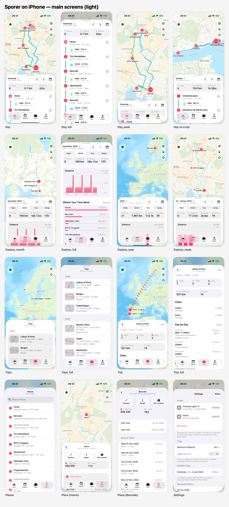
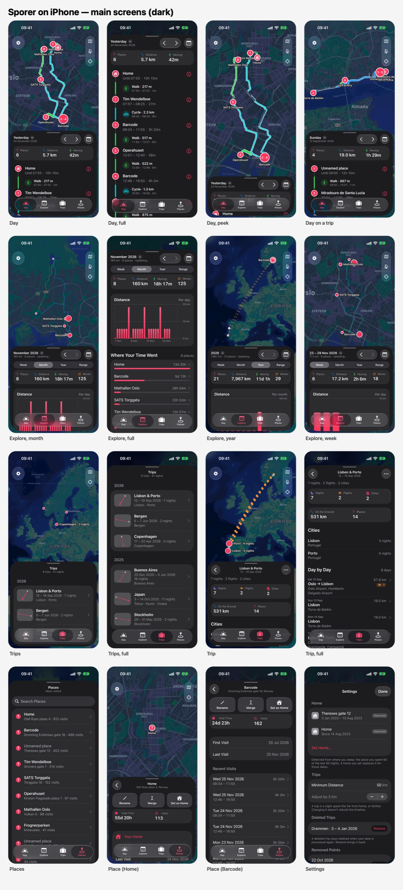
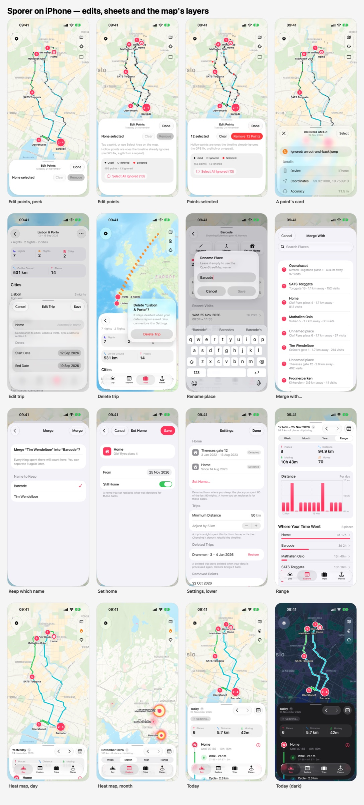
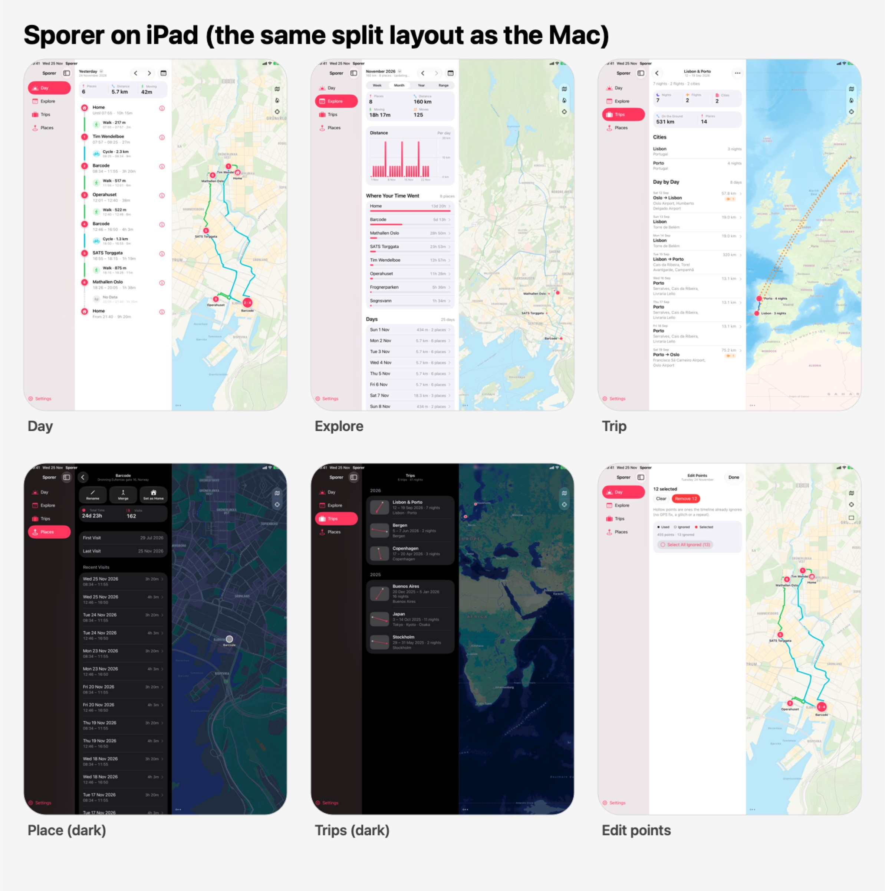
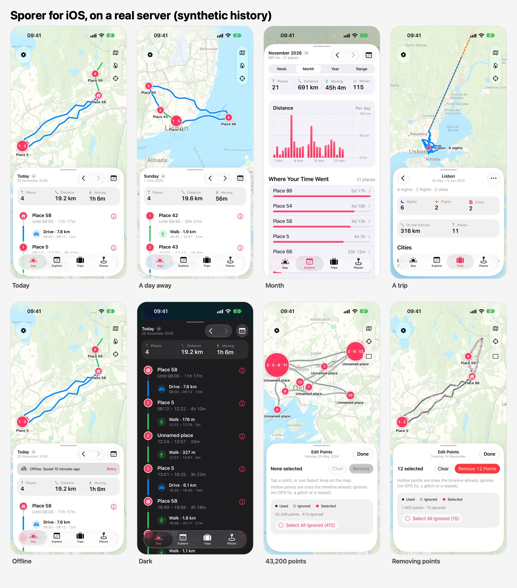

# Sporer native app: design

- **Date:** 2026-11-25
- **Status:** approved by the owner on 2026-11-25 (free Apple account, focus on the iPhone); being built, see §10
- **Prototype:** `ios/` (Xcode project `Sporer.xcodeproj`), running on made-up data. Screenshots are in [`assets/ios-design/`](assets/ios-design/)
  and in §8.

Throughout, **(owner)** marks a decision the owner makes before building starts; **(call)** marks a decision made on the owner's behalf that they can overturn.

---

## 1. Intent

The web app works, but on the iPhone it feels like a web page: the sheet, the map and the controls are imitations of iOS ones. The owner wants a real app,
for iPhone and, through Mac Catalyst, for the Mac, that looks and behaves like one of Apple's own on iOS 27 (Liquid Glass), with the user experience of
*Replay: Life & Travel Map*, which the owner paid for and liked, and which no longer works.

The app replaces the web app's interface. It reads and edits the same timeline through the same API (`README.md`), which does not change.
The web app stays, for any browser.

## 2. What was learnt from Replay

`replay.ipa` is an App Store build: its executable is encrypted (FairPlay), so its code cannot be read. Its resources can: the 486 strings of its
interface, its data model and its asset catalog, which holds four screenshots of its own screens. From those:

- **The map is the whole screen.** Everything else floats on it: a bottom sheet with detents, and round glass buttons at the top (settings on the
  left; location and fit on the right).
- **The sheet carries the app's tab bar**, as Find My does: *Day, Explore, Notes, Activities*. Pulled down, the sheet keeps its header and the tab bar.
- **The day is one vertical rail.** A visit is a disc on the rail with the place's name and `10:30 AM – 12:00 PM · 1h 30min`; a move hangs between
  two visits with its mode's symbol and `Cycling · 1h 15min · 4.5 km`. Home and work get their own icons and colours. The map's pins match the discs.
- **The header** says *Day*, the date with a ⌄ to pick another, and ‹ › to step.
- **Explore** has period stats (last 7 days, 30 days, this year, all time) with "vs last period" and a week streak.
- What Sporer does **not** take from Replay: recording on the phone (Overland does it), activities you start and stop, photos, notes and tags,
  iCloud backup, imports from Google, Arc, Strava and others, and subscriptions.

Nothing of Replay's code, images or text is used. The ideas above are its interaction design, rebuilt with Apple's components.

## 3. Decisions for the owner

| # | Question | Proposal |
| --- | --- | --- |
| 1 | **Tracking.** Should the app also record location in the background, and replace Overland? | **No, not now (call).** Overland keeps recording and the app only shows and edits. Recording reliably all day is a project of its own (battery, motion, background limits, upload queue); it can come after v1. |
| 2 | **Map provider.** The web app uses OpenFreeMap tiles because MapKit JS needs a paid developer account. Native MapKit needs no key on any account. | **Apple Maps (MapKit) (call)**, in a muted style so the routes stand out, switchable to standard, hybrid or satellite. Place *names* still come from the server (OpenStreetMap). Map labels follow the phone's language. |
| 3 | **Installing on the iPhone.** With a free Apple developer account, an app installed from Xcode stops opening after **7 days** and must be installed again from the Mac; TestFlight is not available. The paid program ($99 a year) removes that. The Mac build runs without the limit. | **Free account (owner, 2026-11-25)**, with a weekly reinstall from Xcode (README, "The native app"). |
| 4 | **Sign-in.** Today the server is reachable over the VPN only, with no login. When Authentik forward-auth is added, the app has to sign in: an in-app web sign-in that keeps Authentik's session cookie. | **Not in v1 (call)**, as for the web app. The app's network layer treats a redirect to a login as "signed out" so adding it later touches one place. |
| 5 | **Offline.** The web app shows nothing without a network. | **v1 keeps recent answers on the phone (call)**, so a day you looked at opens at once and is refreshed in the background; with no network, it is shown with a note that it may be out of date. |
| 6 | **Accent colour.** | **The pink of the stop pins and the icon (call)** (`#FF375F`) for buttons and the selected tab, instead of the system blue, which is the colour of driving on the map. |

## 4. Layout and navigation

### 4.1 iPhone

- **The map fills the screen**, edge to edge, under the status bar.
- **A sheet stays over it** at three heights: a **peek** (148 pt: the panel's title bar and the tab bar), **half** (46 % of the screen) and **full**.
  At peek and half the map stays usable behind it. Tapping something that the map should show (a stop, a move, a place) lowers a full sheet to half.
- **The sheet's tab bar** has the four parts of the app: **Day, Explore, Trips, Places**. Each tab is a navigation stack: a day opens a place, a
  trip opens a day, and so on, with the system back button. The tab bar hides itself in edit mode.
- **Floating glass buttons** on the map: **Settings** at the top left; at the top right one glass capsule with **Map style** (a menu: Muted,
  Standard, Hybrid, Satellite, and Fade routes), **Heat map** (on views that have one) and **Recenter**. In edit mode a separate **Select Area**
  button joins it.
- **Settings** opens as a sheet over everything.
- Toasts after a write ("Removed 12 points", with Undo) appear at the top of the map, on glass.

### 4.2 iPad and Mac

- A **three-column split view**: a sidebar with the four parts and Settings; the panel of the part (the same views as the iPhone's sheet,
  320–460 pt wide); and the **map** filling the rest of the window, with the same glass buttons.
- **Mac menu "Go"** and iPad keyboard shortcuts: ⌘← and ⌘→ for the previous and next day, ⌘T for today, ⌘1–⌘4 for the four parts.
- The iPhone app is also resizable on iOS 27 (new in 27); below the compact width it is the iPhone layout, above it the split view.

## 5. Screens

Every screen handles loading (a placeholder in the shape of its content), empty ("No Data"), error (why, and **Try Again** when asking again can
help) and pending ("Updating…" while the server still has points to process). While the next day or period loads, the last one stays on screen,
dimmed, never a blank. Wording, number formats and rules are the web app's: English, 24-hour clock, metric, weeks from Monday, and every time on the
clock of the place it happened in.

### 5.1 Day

- **Title bar:** "Today", "Yesterday" or the weekday, with the date under it; ‹ › to step (› stops at today) and a calendar button. The title has a
  menu: *Go to Today*, *Edit Points*, *Show Week*, *Show Month*.
- **Summary card:** places, distance, time moving.
- **The rail:** a stay is a pink disc numbered like its pin on the map (a house for home, grey for a stay with no place), its name, and
  `08:34 – 11:55 · 3h 20m` ("Until 07:55" for one that began the day before, "Since 21:40" and a **Now** tag for the stay going on). A move is the
  rail itself drawn in its mode's colour, with the mode's symbol, `Cycle · 2.3 km` and its times. A gap is the rail broken, "No Data" and how long.
- **Tapping a row** shows it on the map (and lowers a full sheet); **ⓘ** on a stay opens its place; a long press offers both.
- **A move's mode by hand:** a long press on a move (a right click on the Mac) offers *Show on Map* and a *Mode* menu: the six modes with the
  current one checked, and *Use Detected Mode* when the owner set it (the transit design, §5). Choosing a mode saves it as the owner's, the checked
  one of a detected move too: that keeps it when detection would change it later, as on the web. The mode the owner set is saved again too: after
  *Use Detected Mode* the row shows it until the server has rebuilt the stretch, while the edit itself is gone.
  VoiceOver offers the same as actions ("Keep Mode as Drive" for the detected one). One change at a time: while a mode is being saved, no move
  offers the menu or the actions.
- **Map:** the routes in the mode colours (walk green, cycle teal, drive blue, bus brown, train purple, flight orange dashed along the great circle)
  on a white casing; a disc per place with the stay numbers ("2 · 4" for a place visited twice) and its name under it.

### 5.2 Explore (week, month, year, range)

- **Title bar:** the period ("November 2026") with a summary under it ("160 km · 8 places"); ‹ › and a calendar (a calendar for a week, month
  and year wheels for a month or a year, from and to dates for a range). ← and → step on a keyboard.
- **Segmented control:** Week, Month, Year, Range, pinned under the title bar.
- **Summary card** (places, distance, moving, moves), a **bar chart of distance per day** (per month in a year; tap a bar to read it),
  **Where Your Time Went** (the top ten places by time, with bars; Show All), and **Days** (each day's distance and places; tapping opens the day).
- While a period that includes today is still being processed it refreshes itself, as the web app does, and says "Updating…" under its title.
- **Map:** every route of the period, faded so that frequent ones darken, places as dots sized by time, the five biggest named. The flame button
  draws the heat map.

### 5.3 Trips and a trip

- **Trips:** cards grouped by year: a drawing of the trip's line (home, the places slept at, home), its name, dates and nights, its cities, and
  "Ongoing". The map shows every city stayed in, sized by nights.
- **A trip:** name and dates in the title bar, ‹ › to the older and newer trip, and a menu with *Edit Trip* and *Delete Trip*. A summary card
  (nights, flights, cities, distance on the ground), the cities, and **Day by Day** (each day's line, "Oslo → Lisbon", its highlights and distance;
  tapping opens the day). The map shows the whole trip with its flights.
- **Edit Trip** is a form (name, start and end date, Use Detected Dates); **Delete Trip** asks first, and the toast after it has **Undo**.

### 5.4 Places and a place

- **Places:** your places, most visited first, with search.
- **A place**, laid out like a place card in Apple Maps: name and address, a row of glass buttons (**Rename**, **Merge**, **Set as Home**), total
  time and visits, first and last visit, the places merged into it (each with **Separate**), and the recent visits (tapping opens the day).
- **Rename** is an alert with a text field (empty brings OpenStreetMap's name back). **Merge** picks the other place from the nearest ones or a search,
  then asks which name to keep.

### 5.5 Edit points (a day)

- From the day's title menu. The sheet drops to its peek and the tab bar goes, so the map has the room. The map draws every raw point of the
  day: used ones filled, ignored ones hollow, selected ones red.
- **Tap** a point to select it and see its card; **Select Area** on the map, then drag a box.
- The panel's first row, visible at the peek: "12 selected", **Clear** and **Remove 12 Points**. Under it: what hollow points are, a legend,
  the counts, and *Select All Ignored*.
- After a removal the toast has **Undo**; Settings lists every removal with **Restore**.
- **A point's card:** its time and date, whether the timeline uses it and why not, device, coordinates, accuracy, speed, altitude, motion,
  the stay or move it is in, and its neighbours.

### 5.6 Settings

A system settings form, in the web app's order, so the things you change come first: **Home** (the periods, detected and yours; Set Home;
swipe to remove yours), **Trips** (the distance that makes a trip, with a stepper and Reset to Default), **Deleted Trips** and **Removed Points**
(each with Restore), **Processing** (backfill, last run, waiting and failed periods with Retry Failed), **Map** (style, fade routes), **Server**
(address, connection, algorithm version) and **About**. When the server can't be reached, a row at the very top says so ("Are you on the VPN?").

## 6. Visual language

- **Apple's components first:** navigation bars, toolbars, tab bars, sheets, forms, menus, alerts and confirmation dialogs, which take Liquid Glass
  and iOS 27's changes to it by themselves. Custom glass is limited to the buttons floating on the map.
- **Colour:** the system's mode colours (green, teal, blue, brown, purple, orange); the pink pin and accent; everything else is the system's
  label and background colours, so light and dark mode are both right.
- **One stop, one disc:** the disc on the rail and the pin on the map are the same object, with the same number.
- **Type:** the system font (SF Pro), rounded digits in the discs, monospaced digits for times and figures; Dynamic Type throughout.
- **Accessibility:** every row and button is labelled for VoiceOver; nothing depends on colour alone (modes have symbols, stops have numbers).

## 7. How it is built (call)

- **SwiftUI**, iOS 27 and Mac Catalyst (macOS 27), Swift 6 with strict concurrency, **no third-party packages**.
- **The map is MapKit's `MKMapView`** wrapped for SwiftUI, because SwiftUI's own `Map` cannot draw custom overlays: the heat map and edit mode's
  tens of thousands of points are drawn by custom renderers, routes as one multi-polyline per mode.
- **`SporerService`** is the API, one method per endpoint. `MockService` (the prototype's made-up data, with real street routes computed once with
  MapKit) answers in previews and tests; the HTTP client answers in the app.
- **Checks run on this Mac and the iPhone, not on GitHub Actions (owner):** unit tests with `xcodebuild test` on the simulator, a Mac Catalyst build,
  screenshot checks of every screen in light and dark, and a final pass on the iPhone itself. The scripts in `ios/scripts/` build, test, run and
  install it (`ios/README.md`).

## 8. The prototype

Every screen above is built and runs on made-up data (a person in Oslo with a weekday commute, weekends out, and a trip to Lisbon and Porto,
on real street routes). Edits work against that data in memory: renames, merges, removed points with Undo, trip edits, homes.

| | |
| --- | --- |
|  |  |
|  |  |

- **Dark mode (call):** the half-height sheet uses a dark material instead of the clear glass, which turned pale over the dark map and made white text
  hard to read. Light mode keeps the system's glass.
- **Trips on several continents (call):** a flat map cannot show Oslo, Buenos Aires and Tokyo at once on a phone, so the map of the trips list opens
  on home with the nearby trips, and the others are a pan away (MapKit's globe takes over when zoomed far out).
- **The Mac:** it builds and runs as a Mac Catalyst app with the iPad's layout. On macOS 27 a toolbar *group* of buttons crashes Catalyst's toolbar,
  so toolbars use separate items (they look the same on iOS).
- **Left from the prototype, now settled:** Rename is prefilled with the place's shown name, and saving it unchanged changes nothing, which is what
  the web app does (the API does not say which name is the owner's: an `ownName` field on `GET /api/places/{id}` would let both prefill only the
  owner's own); a point's card names zones as the web app does ("CET", "WET", "EST"); the screenshot launch flags work in debug builds only.

Checks run so far, all on this Mac: the iPhone and iPad simulators (iOS 27), a Mac Catalyst build, and 31 unit tests of the formatting rules, the
date arithmetic and the decoding of the API's JSON.

## 9. Build order after approval

1. **HTTP client and caching:** the API client behind `SporerService`, server address in Settings, the signed-out and offline handling, the response
   cache; tests against the JSON of the server's own records.
2. **Wire every screen** to it, with the refresh rules of the web app (polling while pending, refetch on return to the app, a day that rolls over).
3. **Edits end to end** against a local server with the synthetic history.
4. **Mac Catalyst polish:** menus, keyboard, pointer, window sizes.
5. **Performance pass** on the iPhone with the real history (a year of routes, a day of 40 000 points), and the owner's checklist.

## 10. Build progress

**Done (2026-11-25), checked on this Mac against a local server with the synthetic history:**

- **The HTTP client** (`ios/Sporer/Data/`): every endpoint, JSON both ways (microsecond times), `ETag` and `304`, no redirects followed (a redirect is
  "signed out"), the API's own error messages shown as they are, `{}` for a write with no body, and every write tells all the screens to load again.
- **Offline and caching** (decision 5): the last answer of every view is kept on the device; a view opens at once on it while the server is asked,
  and shows it with "Offline. Saved … ago." when the server can't be reached. A view never seen says why it can't load, with Try Again.
- **The web app's refresh rules:** pending every 30 s (3 s for two minutes after an edit of a day's points), today every minute, everything on screen
  after more than 30 s in the background, and the Day tab moves on at midnight.
- **Every screen** is wired to the server, and every edit was done against it: removing points with Undo and restoring them from Settings,
  renaming, merging and separating places, setting and removing a home, editing, deleting and restoring a trip, the trip distance, Retry Failed.
- **Fixes found with real data:** stop names on the map no longer cover each other or other stops (the name of the place with the most time wins);
  a drawing is fitted clear of the map's buttons; the map always draws what the top-most screen asks for (the trips list under an open trip no longer
  takes it back); a trip is framed on where it went, with the flights there and back leading off the screen, and anything wider than a quarter of the
  world is shown on the globe; the Mac toolbar no longer crashes on launch (one toolbar item on the Mac: AppKit's own grouping of adjacent items
  crashes on macOS 27).
- **Checks:** 136 unit tests (formatting, dates, decoding of the server's own JSON, the HTTP client against a stub server, the response store, the
  refresh rules), 12 tests that send every write to the local server and undo it, screenshots of every screen on iPhone (light and dark) and iPad,
  offline with the server stopped, a day of 43 200 points, the Mac app launched under the debugger, and a signed Release build for the iPhone.

**On the owner's iPhone (2026-11-25):** installed with the free account and opened on the real server over the VPN. Today, a year (871 places), a
month's map, the 35 trips on the globe, the places and Settings all load the real history. Two things only the real screen showed were fixed: a drawing
fitted under the status bar and the Settings button (fits now keep clear of the row of buttons), and home drawn over the numbers of a stop beside it.

**A review for real-data risks** (four Sonnet reviewers, each finding checked by a Sonnet skeptic; 7 confirmed, all fixed): a screen whose first load
failed stopped refreshing (it now retries after 5 s, 15 s, then every 30 s, and so does an offline copy); the map kept the old drawing when a refresh
changed it but not its date or number of moves (it now redraws without moving); the heat layer vanished after a refresh; edit mode never reloaded the day
after a removal; a removal downloaded the day's points twice; "today" kept the zone the app started in after a flight; the Day calendar capped dates at
UTC's today.

**Building it:** `ios/scripts/` builds the app for the simulator, the iPhone and the Mac, runs the unit and live tests, opens it in a simulator
or on the Mac, and installs it on the iPhone over Wi-Fi (saying when the free account's profile ends); `ios/README.md` explains them.

**Still to do:** the owner's own checklists on the phone (README) and speed on the densest real days; Mac polish (menus, pointer, window sizes).

